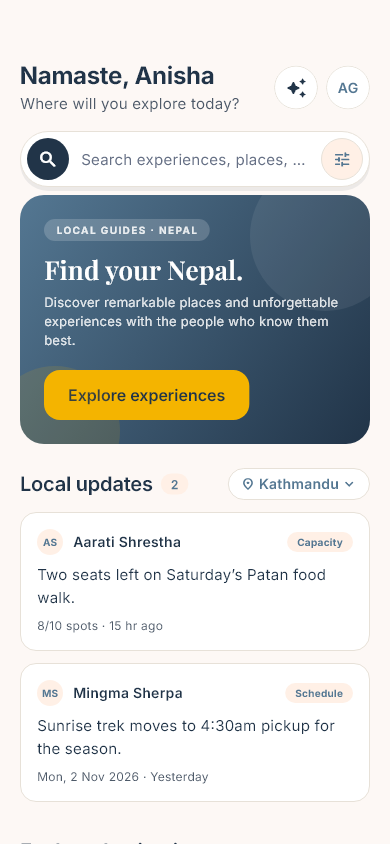
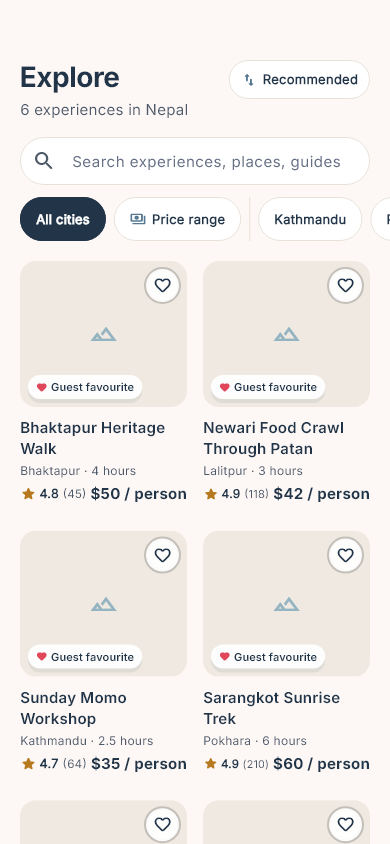
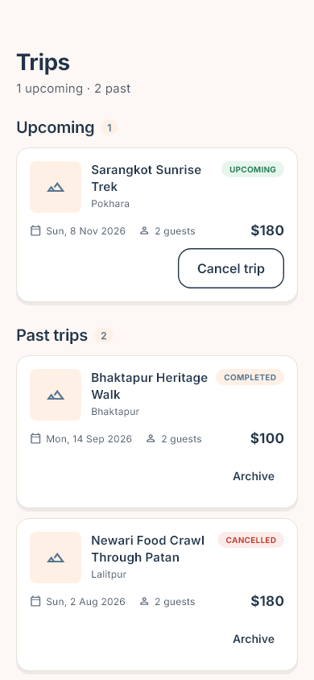
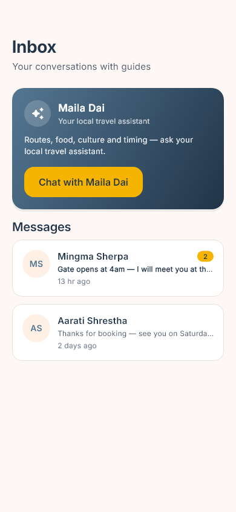
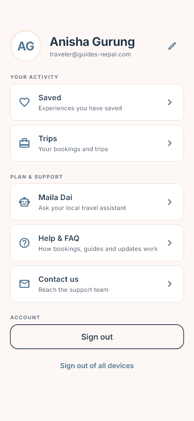
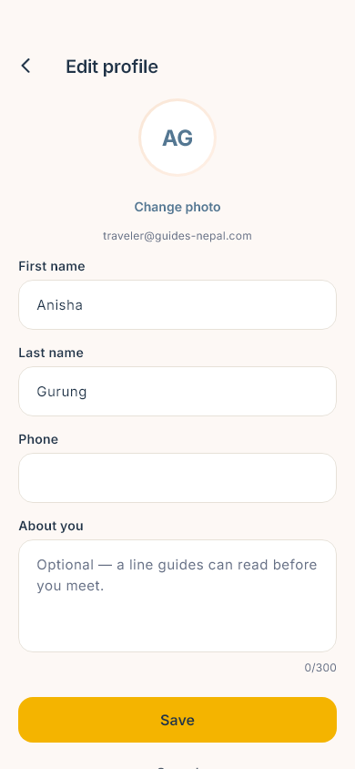
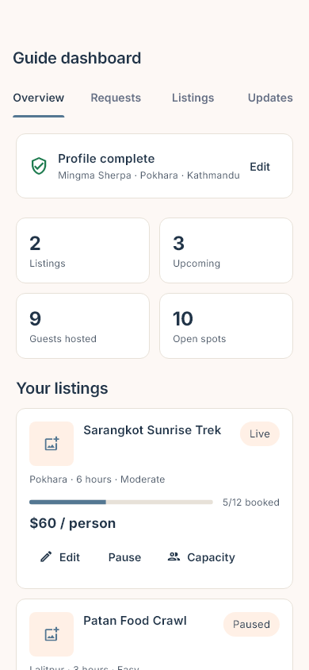
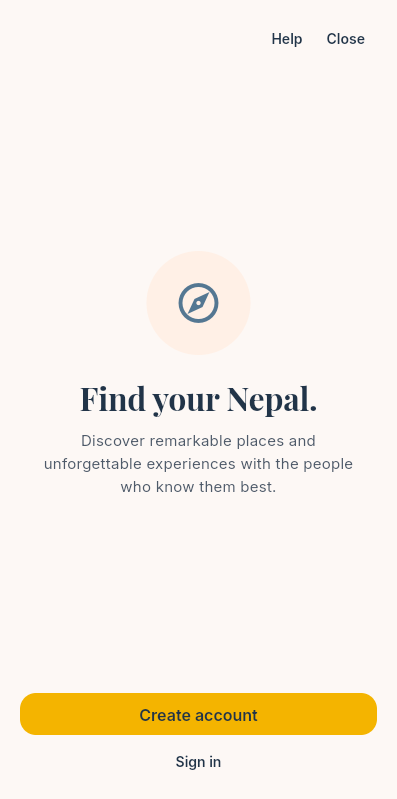
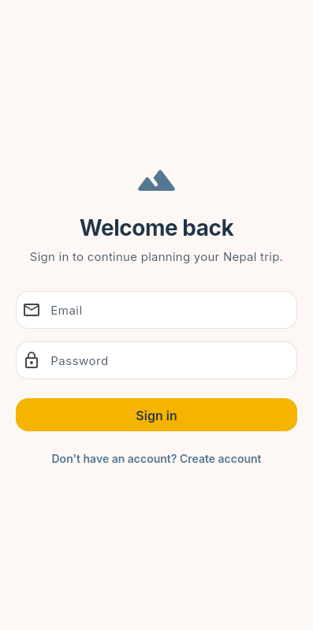

# Design System

Tokens live in `lib/app/theme/` (`app_colors.dart`, `app_spacing.dart`,
`app_typography.dart`, `app_theme.dart`); components in `lib/shared/widgets/`.
The rules in this document are enforced by
[`test/design_system_guard_test.dart`](../test/design_system_guard_test.dart),
not by memory — see [Design contract](#design-contract).

## 1. Brand colours

Derived from the website's Tailwind theme so site and app share one identity.

| Token | Hex | Use |
|---|---|---|
| `primary` | `#213448` | deep Himalayan blue — headings, dark plates |
| `secondary` | `#547792` | medium blue — links, secondary actions |
| `tertiary` | `#94B4C1` | mist blue — subdued icons, placeholders |
| `accent` | `#F4B400` | brand yellow — the primary CTA fill (always with `#213448` ink) |
| `background` | `#FDF8F5` | warm cream canvas |
| `surface` | `#FFFFFF` | cards, sheets, input fills |
| `surfacePeach` / `peach` | `#FFF0E6` / `#F9E6D6` | warm highlights, chips, hero blocks |
| `border` | `#E7E1D8` | warm hairline borders |
| `shimmerBase` / `shimmerHighlight` | `#EFE9E1` / `#FAF7F2` | skeleton loading |
| `textPrimary` / `textSecondary` / `textTertiary` / `textDisabled` | `#213448` / `#667085` / `#98A2B3` / (disabled ink) | the text ramp, in emphasis order |
| `success` / `successSurface` | `#1E7B4F` / `#E8F5EE` | confirmed states |
| `warning` | `#B7791F` | warnings |
| `error` / `errorSurface` | `#C0392B` / `#FBECEA` | failures, cancellations |
| `iconRating` | `#B7791F` | rating stars — brand yellow fails 3:1 as an icon |
| `favoriteActive` | `#E0475B` | saved heart |
| `shadowTint` | `8% primary` | every elevation is primary-tinted, never grey |

### On-image ramp

Photography and the brand plates need white-on-dark, which the cream palette
cannot express. These are the only sanctioned whites:

| Token | Value | Use |
|---|---|---|
| `onImageTextPrimary` | `#FFFFFF` | icon or headline directly on a photo |
| `onImageTextSecondary` | `86% white` | supporting line on a photo or plate |
| `onImageFill` | `18% white` | chip / avatar circle over imagery |
| `onImageFillStrong` | `22% white` | floating control (glass icon button) |
| `onImageBorder` | `40% white` | hairline around a glass control |
| `onImageSurface` | `94% white` | the opaque glass pill (save heart, badge) |
| `onImageShadow` | `18% black` | drop shadow for a control sitting on a photo |
| `ornamentFill` | `7% white` | decorative hero glow |
| `imageScrimTop` / `imageScrimBottom` | `40% black → transparent` | icon-legibility scrim; never dims the whole photo |

Rules: no pure black anywhere; white is for cards and on-image glass only, not
as a page background; no decorative gradients except the two brand blues used
as an editorial plate and the per-city destination tiles.

### Brand artwork

Three supplied files, all cut from the same mark (navy `#213448` — the same
value as `AppColors.primary` — with `#FFBA0A` squares). Build-time masters sit
in `brand/` (outside `assets/`, so they are not bundled); the two images the UI
draws live in `assets/brand/` and are used through `AppLogoMark` /
`AppLogoLockup`, never as bare `Image.asset` calls.

| Artwork | Where it appears | Notes |
|---|---|---|
| `brand/app_icon*.png` | launcher icon (Android legacy + adaptive, iOS) | generated into the platform resources by `flutter_launcher_icons`; not drawn by a widget |
| `brand/splash_logo*.png` | the OS launch screen | generated by `flutter_native_splash`; white ground, because `GUIDES` in the lockup is navy |
| `assets/brand/logo_lockup.png` | `SplashScreen`, onboarding header | full mark + wordmark, navy ink on a light ground only |
| `assets/brand/logo_mark.png` | sign-in, sign-up, profile chrome | the circular mark alone, for anywhere the wordmark would be too small to read |

Two constraints are baked into the generated assets and should survive any
re-cut: **iOS icons carry no alpha** (a transparent plate shows white corner
nibs inside iOS's own mask), and the **Android 12+ splash image is masked to a
circle**, so the lockup is pre-fitted to that circle — widen it and the ends of
the wordmark are cut off.

Regenerate after replacing the artwork:

```bash
dart run flutter_launcher_icons
dart run flutter_native_splash:create
```

## 2. Typography

- **PlayfairDisplay** (bundled, SIL OFL) — editorial display: `displayLarge`
  40 / `displayMedium` 32 / `displaySmall` 26.
- **Inter** (bundled, SIL OFL) — every other style.

| Role | Token | Size / weight |
|---|---|---|
| Screen title | `h1` | 28 / 700 |
| Section title | `h3` | 20 / 600 |
| Card title | `subtitle` | 15 / 600 |
| Body | `body` | 15 / 400, 1.55 line height |
| Supporting | `caption` | 12 / 400, secondary ink |
| Form label / button body | `label` | 14 / 600 |
| **Button** | `button` | 16 / 600 |
| **Counts, nav labels, timestamps** | `badge` | 11 / 600 |
| **Status pills, badges, initials** | `micro` | 10 / 700 |
| **Uppercase kicker** | `eyebrow` | 10 / 700, 1.4 tracking |
| Prices | `priceSmall` 15 · `price` 17 · `priceMd` 18 · `priceLarge` 26 | 700 |
| Overline (secondary blue) | `overline` | 12 / 600, 1.1 tracking |

Both families are variable fonts; the `wght` axis is set through
`FontVariation`. `micro`/`badge`/`eyebrow` exist so the smallest chrome type is
a decision, not a per-screen guess — no widget may declare its own size.

## 3. Spacing, radii, elevation

- Scale `4 · 8 · 12 · 16 · 20 · 24 · 32 · 40 · 48 · 64` (`AppSpacing.x1…x16`),
  screen `gutter = 20`, `minTouchTarget = 44`.
- Radii: `sm 8` (inputs, small images) · `md 12` (buttons, fields) · `lg 16`
  (cards) · `xl 20` (hero blocks, dialogs) · `xxl 24` (Home hero) · `pill 999`
  (chips, search). Buttons are 12, cards 16 — nothing is a pill by default.
- Elevation is two levels: `AppShadows.card` (felt, not seen) and
  `AppShadows.floating` (chrome that overlays content: nav bar, booking bar).

## 4. Components (`lib/shared/widgets/`)

| Component | States / notes |
|---|---|
| `AppButton` | primary (yellow) / secondary (blue) / outline / ghost; **loading** blocks double-submit; 44 dp+ targets; `expanded` |
| `AppTextField` | label, error text, password reveal, semantics; labels sit above the field from the first frame (the theme sets `FloatingLabelBehavior.always`, so a bare `TextFormField` in a form cannot opt out) |
| `ExperienceCard` | 4:3 photo, save heart (never covers the title), meta line, rating row, per-person price; one accessible label reading title/city/rating/price |
| `GuideCard` / `GuideAvatar` | portrait with initials fallback |
| `BookingStatusChip` | **the only** booking-status vocabulary: `upcoming/accepted` → success, `completed` → peach, `cancelled/rejected` → error, `archived` → neutral. Word carries the state; colour is redundant |
| `NetworkImageView` | cache + shimmer + error fallback, `maxWidthDiskCache: 1600` |
| `ScreenHeader` / `SectionHeader` | tab header and section header with optional action |
| `AppFilterChip` / `InfoChip` | selected + unselected / static label |
| `SkeletonBox` / `SkeletonList` | shimmer loading, respects reduced motion |
| `EmptyStateView` / `ErrorStateView` | icon + copy + optional action / retry |
| `FloatingNavBar` | 68 dp rounded panel; the active tab sits in a raised surface disc nested in a notch and outlined by a cream halo (navy glyph on white, active label in brand ink); unread badge; Cupertino feel on both platforms |
| `AppLogoMark` / `AppLogoLockup` | the bundled brand artwork (size by width only — the set's proportions hold); the lockup needs a light ground, the mark works on any |

Interactions: hearts animate and reconcile with the server; sheets and dialogs
come from the theme; `pageTransitionsTheme` uses Cupertino transitions on **both**
platforms. Animations are disabled under reduced motion
(`MediaQuery.disableAnimationsOf`).

## 5. Layout rules

- Designed for 360×800 → 430×932 logical pixels, verified at 390×844.
- Single column, scroll-first. No fixed height around text: `minHeight`
  constraints only, so system font scaling reflows instead of striping.
- Horizontal rails (`ListView` + `SizedBox` height) for cities and related
  content; vertical grids are two-up and scale with the cell width.
- Content scrolls beneath the floating nav bar; each screen owns its
  `SafeArea`, and a persistent booking bar adds that inset itself.

## 6. Accessibility

- Touch targets ≥ 44 dp; nav bar 68 dp; 8 dp minimum between neighbouring taps.
- Screen-reader semantics on cards, hearts, images, buttons, status chips and
  the unread badge; decorative ornaments are excluded.
- Text scaling left at the system default; type carries `height` so lines
  reflow rather than clip.
- Contrast is asserted, not assumed: text ≥ 4.5:1, meaningful non-text ≥ 3:1
  (rating stars use `iconRating` precisely because `accent` fails as an icon).
- Status is never colour-only — the chip label spells the state.
- Light theme only. Dark mode ships only when it can be done coherently; the
  decision is pinned by a test rather than left as an oversight.

## 7. Copy

`lib/l10n/app_strings.dart` owns user-facing copy. The migration is not
finished: some flows still interpolate sentences inline. The guard test pins
that count at 71 so it can only fall — new copy goes into `AppStrings`, and each
screen that moves its copy there lowers the baseline. Dates, money and relative
times are formatted centrally in `lib/core/utils/formatters.dart`.

## 8. Design contract

`test/design_system_guard_test.dart` scans the real source and fails the build
on any of these:

| Rule | Why |
|---|---|
| No `Color(0x…)` outside `lib/app/theme/` | one palette, one place |
| No `Colors.white/black/grey/…` outside the token layer | Material's palette bypasses the warm identity |
| No `fontSize:` outside the token layer | the type scale is the only sizes that exist |
| No literal `fontFamily:` outside the token layer | Playfair/Inter are chosen centrally |
| Inline-copy count never rises (ratchet, baseline 71) | translation has one home |
| No second `BookingStatus` → colour map outside `BookingStatusChip` | one status vocabulary across Trips and the guide workspace |
| Contrast ratios hold for every text pair (WCAG 2.1 AA) | measured, not eyeballed |

`test/design_tokens_test.dart` holds the palette/contrast half; the guard holds
the discipline half. Together they make "the design system" a thing the build
checks.

## 9. Reference screens

Rendered by `test/design_capture_test.dart` — the real screens, the real theme,
the bundled Inter/Playfair/MaterialIcons fonts, a scripted transport and a
390×844 viewport — so the tokens in this document can be checked against
pixels. Regenerate any time:

```bash
flutter test test/design_capture_test.dart --dart-define=CAPTURE_SCREENS=true
```

Without that define the cases are skipped, so the ordinary suite has nothing
extra to flake on. The one thing captures cannot show is photography: the
transport is faked, so every photo is the branded placeholder.

| Screen | Capture |
|---|---|
| Home |  |
| Explore |  |
| Trips |  |
| Inbox |  |
| Profile |  |
| Edit profile |  |
| Guide workspace |  |
| Onboarding (captured before the pager indicator) |  |
| Sign-in (captured before labels were pinned) |  |

### What the captures caught

The first review pass found four defects that reading the code had not:

1. **The "Guest favourite" ribbon slid under the save heart.** On a two-up grid
   cell the ribbon and the 33 dp circle shared the same corner. It now sits at
   the **bottom-left** of the photo on every card — one consistent corner the
   heart never occupies — so the label stays whole ("Guest favou…" was the
   compromise when it was merely squeezed).
2. **`14 h ago`.** Hours were the only unit abbreviated with a space; the row
   now reads `14 hr ago`, matching `12 min ago` and `4 days ago`.
3. **`6 experiences across Nepal` orphaned the country** onto a second line
   beside the sort control. It reads `6 experiences in Nepal`.
4. **The capture harness itself lied twice:** a missing status-bar inset clipped
   every screen title, and a fixture returned `listings: []` next to a
   `2 listings` stat, so the workspace showed an empty state contradicted by its
   own numbers. Both are fixed in the harness — a misleading capture is worse
   than none.

Two earlier defects, found in the first web capture, are fixed too:

- **Resting labels were invisible.** Inputs showed a label only once filled,
  so an empty form had nothing to announce and nothing to scan. The theme now
  floats every label from the first frame (`FloatingLabelBehavior.always`),
  pinned by a token test.
- **The pager did not admit it was a pager.** Three onboarding slides existed
  with no indicator, so slide two was undiscoverable. Dots now show position,
  carry `Page 2 of 3` semantics, and jump to a slide when tapped (44 dp targets,
  motion honours reduced-motion) — pinned by `test/onboarding_pager_test.dart`.

Still open after this pass:

- The onboarding column keeps one promise between a 104 dp icon and three lines
  of copy, so the space above the CTA reads as a gap rather than rhythm. That
  needs a real hero treatment (photography or an illustration), not padding.
- (Resolved) Profile editing now exists at `/profile/edit`: the identity row
  carries an edit control, and name, photo, phone and bio are all editable with
  live validation. The photo key had to be `avatar_url` — the response spells
  it `avatarUrl` and `ProfileUpdate` ignores unknown keys, so the camelCase
  spelling would have stored nothing and still returned 200.
- Trips cards do not surface the guide's name or a way to message them, even
  though bookings carry `guide_name` and the Inbox already exists.
